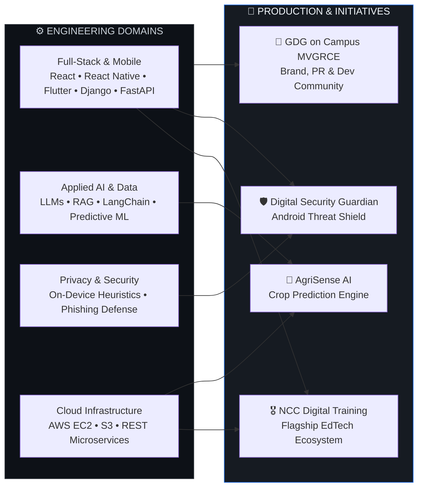

<div align="center">

```text
 █████╗ ██████╗ ██╗  ██╗██╗██████╗  █████╗ ███╗   ███╗    ██████╗  █████╗ ███╗   ███╗██████╗  █████╗ 
██╔══██╗██╔══██╗██║  ██║██║██╔══██╗██╔══██╗████╗ ████║    ██╔══██╗██╔══██╗████╗ ████║██╔══██╗██╔══██╗
███████║██████╔╝███████║██║██████╔╝███████║██╔████╔██║    ██████╔╝███████║██╔████╔██║██████╔╝███████║
██╔══██║██╔══██╗██╔══██║██║██╔══██╗██╔══██║██║╚██╔╝██║    ██╔══██╗██╔══██║██║╚██╔╝██║██╔══██╗██╔══██║
██║  ██║██████╔╝██║  ██║██║██║  ██║██║  ██║██║ ╚═╝ ██║    ██║  ██║██║  ██║██║ ╚═╝ ██║██████╔╝██║  ██║
╚═╝  ╚═╝╚═════╝ ╚═╝  ╚═╝╚═╝╚═╝  ╚═╝╚═╝  ╚═╝╚═╝     ╚═╝    ╚═╝  ╚═╝╚═╝  ╚═╝╚═╝     ╚═╝╚═════╝ ╚═╝  ╚═╝
```

### **SYSTEMS ARCHITECT &nbsp;•&nbsp; FULL-STACK & AI ENGINEER &nbsp;•&nbsp; SECURITY BUILDER &nbsp;•&nbsp; STORYTELLER**

<p>
  <a href="https://www.linkedin.com/in/abhiramssk/"></a>
  <a href="mailto:abhiwork5581@gmail.com"></a>
  <a href="https://instagram.com/pvtly.abhi"></a>
  
</p>

<p>
  
  
  
  
</p>

</div>

---

### `0x00` // SYSTEM MANIFESTO & OPERATING SYSTEM

```typescript
interface BuilderProfile {
  readonly name: "Abhiram Ramba";
  readonly foundation: "Sainik School Korukonda → B.Tech CSE @ MVGRCE (Autonomous)";
  readonly leadership: "Marketing & PR Lead — GDG on Campus MVGRCE (2026–2027)";
  readonly doctrine: string[];
  readonly dualCore: {
    leftBrain: "Distributed Backends, Applied AI/NLP, On-Device Security, Mobile Systems";
    rightBrain: "Published Novelist ('Two States, One Heart') & Episodic Scriptwriter";
  };
}

const abhiram: BuilderProfile = {
  name: "Abhiram Ramba",
  foundation: "Sainik School Korukonda → B.Tech CSE @ MVGRCE (Autonomous)",
  leadership: "Marketing & PR Lead — GDG on Campus MVGRCE (2026–2027)",
  doctrine: [
    "Unconfined to a single stack, niche, or label—if a problem is worth solving, I architect the system to solve it.",
    "Privacy is non-negotiable: sensitive intelligence belongs on-device, not leaked to third-party servers.",
    "Technology scales best when engineered with military-grade discipline and communicated with human storytelling."
  ],
  dualCore: {
    leftBrain: "Distributed Backends, Applied AI/NLP, On-Device Security, Mobile Systems",
    rightBrain: "Published Novelist ('Two States, One Heart') & Episodic Scriptwriter"
  }
};
```

<br/>



---

### `0x01` // FLAGSHIP ARCHITECTURE: NCC DIGITAL TRAINING

<table>
<tr>
<td width="100%" valign="top">

<h2>🎖️ NCC Digital Training Ecosystem &nbsp;  </h2>

<p><strong>Spearheading an end-to-end digital transformation platform for National Cadet Corps (NCC) education across A, B, and C Certificate levels.</strong></p>

<p>Traditional NCC training relies heavily on fragmented physical handbooks and manual evaluation cycles. <strong>NCC Digital Training</strong> replaces that friction with a unified, scalable digital learning and assessment infrastructure engineered for cadets and instructors.</p>

<h4>Core Architectural Pillars</h4>
<ul>
  <li><strong>Standardized Multi-Certificate Curriculum:</strong> Digitized, structured, subject-wise learning repositories mapped directly to NCC <strong>A, B, and C Certificate</strong> syllabi.</li>
  <li><strong>Simulation-Based Mock Examination Engine:</strong> Timed, exam-grade assessment workflows built to replicate real certification testing conditions with instant performance feedback.</li>
  <li><strong>Cadet Progress &amp; Readiness Telemetry:</strong> End-to-end tracking workflows monitoring syllabus completion, mock test accuracy, and longitudinal cadet readiness.</li>
  <li><strong>Institutional Scalability:</strong> Modular backend architecture designed to expand seamlessly across units, battalions, and certification workflows.</li>
</ul>

<h4>5-Phase Rollout Blueprint</h4>

| Phase | System Module | Core Deliverables | Status |
| :--- | :--- | :--- | :--- |
| **Phase 01** | **Curriculum &amp; Resource Core** | Standardized A/B/C Certificate syllabus structuring &amp; digital study modules |  |
| **Phase 02** | **Assessment &amp; Telemetry Engine** | Simulation-based mock examinations &amp; cadet progress tracking workflows |  |
| **Phase 03** | **Instructor &amp; Unit Dashboards** | Cohort analytics, batch-level readiness metrics &amp; automated reporting |  |
| **Phase 04** | **Digital Certification Pipeline** | Verifiable credential issuance &amp; practical drill evaluation rubrics |  |
| **Phase 05** | **Multi-Battalion Scale &amp; Offline Sync** | Low-bandwidth mobile caching &amp; cross-unit institutional onboarding |  |

<p><code>Full-Stack Architecture</code> &nbsp; <code>REST APIs</code> &nbsp; <code>Assessment Engine</code> &nbsp; <code>Database Modeling</code> &nbsp; <code>Institutional EdTech</code></p>

</td>
</tr>
</table>

---

### `0x02` // ENGINEERING LAB & SELECTED SYSTEMS

<table>
<tr>
<td width="50%" valign="top">

<h3>🛡️ Digital Security Guardian</h3>
<p><strong>Privacy-First On-Device Android Threat Assistant</strong></p>
<p>Built to protect everyday mobile users from social engineering and credential harvesting without sacrificing personal data privacy.</p>
<ul>
  <li><strong>Real-Time Interception:</strong> Automated link and notification inspection engine that scans incoming messages for phishing patterns and malicious URLs in real time.</li>
  <li><strong>Zero-Leakage On-Device Scoring:</strong> Executes local threat classification and security risk scoring directly on the Android device—zero reliance on external cloud processing.</li>
  <li><strong>Interactive Cyber Hygiene Module:</strong> Built-in digital safety and awareness workflows training users to recognize emerging phishing vectors.</li>
</ul>
<p><code>Android</code> &nbsp; <code>On-Device Security</code> &nbsp; <code>Notification Heuristics</code> &nbsp; <code>Threat Scoring</code></p>

</td>
<td width="50%" valign="top">

<h3>🌱 AgriSense AI</h3>
<p><strong>ML-Driven Smart Agriculture Inference System</strong></p>
<p>Data-backed decision support system engineered to translate multi-variable agricultural and soil telemetry into actionable crop intelligence.</p>
<ul>
  <li><strong>Predictive Crop Modeling:</strong> Supervised machine learning pipeline trained on real-world agronomic, soil nutrient, and environmental datasets.</li>
  <li><strong>Structured Model-Serving APIs:</strong> Decoupled backend inference endpoints delivering clean, low-latency prediction payloads for downstream applications.</li>
  <li><strong>End-to-End Data Pipeline:</strong> Automated feature preprocessing, validation, and structured data flow from raw telemetry to prediction output.</li>
</ul>
<p><code>Python</code> &nbsp; <code>Machine Learning</code> &nbsp; <code>REST APIs</code> &nbsp; <code>Data Preprocessing</code></p>

</td>
</tr>
</table>

---

### `0x03` // EXPERIENCE, LEADERSHIP & FIELD RECORD

<table>
<tr>
<td width="50%" valign="top">

<h4>💼 Engineering Internships</h4>
<ul>
  <li>
    <strong>AWS Generative AI &amp; Cloud Intern</strong><br/>
    <em>Sept 2025 – May 2026</em>
    <ul>
      <li>Engineered cloud-native Generative AI workflows and integrated foundation models into scalable application architectures.</li>
      <li>Hands-on deployment, storage, and infrastructure management across <strong>AWS EC2</strong> and <strong>S3</strong>.</li>
    </ul>
  </li>
  <br/>
  <li>
    <strong>React Native Intern — EduSkills Academy</strong><br/>
    <em>Apr 2026 – Jun 2026</em>
    <ul>
      <li>Completed an intensive 8-week mobile engineering internship building production-ready cross-platform apps.</li>
      <li>Implemented complex navigation, state management, <strong>geofencing</strong>, <strong>maps</strong>, camera integration, and local persistence.</li>
    </ul>
  </li>
</ul>

</td>
<td width="50%" valign="top">

<h4>🏛️ Leadership, Hackathons &amp; Community</h4>
<ul>
  <li>
    <strong>Marketing &amp; PR Lead — GDG on Campus MVGRCE</strong><br/>
    <em>2026 – 2027</em>
    <ul>
      <li>Directing brand strategy, public relations, developer outreach campaigns, and campus-wide technical event communications.</li>
    </ul>
  </li>
  <br/>
  <li>
    <strong>2nd Position — Google TechSprint 2025</strong><br/>
    <em>Competitive Technology Hackathon</em>
    <ul>
      <li>Secured runner-up honors for rapid end-to-end solution architecture and high-impact product execution under tight constraints.</li>
    </ul>
  </li>
  <br/>
  <li>
    <strong>Open-Source Volunteer — Swecha &amp; Hack24</strong><br/>
    <em>Aadhrita 2026 &amp; Campus Inductions</em>
    <ul>
      <li>Led technical induction sessions for freshers on Git, developer workflows, and open-source culture; supported technical &amp; event ops for Hack24.</li>
    </ul>
  </li>
</ul>

</td>
</tr>
</table>

---

### `0x04` // FULL-SPECTRUM TECHNICAL ARSENAL

| Architecture Layer | Technologies &amp; Tooling |
| :--- | :--- |
| **Core Languages** |       |
| **AI, LLMs &amp; Data Science** |      |
| **Web, Mobile &amp; Backend** |        |
| **Cloud, Security &amp; DevOps** | -232F3E?style=for-the-badge&logo=amazonaws&logoColor=white)      |

---

### `0x05` // LIVE GITHUB TELEMETRY

<div align="center">

<table>
<tr>
<td width="50%" align="center">
  
</td>
<td width="50%" align="center">
  
</td>
</tr>
<tr>
<td colspan="2" align="center">
  
</td>
</tr>
</table>


</div>

---

### `0x06` // CREDENTIALS, EDUCATION & BEYOND THE TERMINAL

<details open>
<summary><b>🎓 Academic Pedigree &amp; Verified Certifications</b></summary>
<br/>

<table>
<tr>
<td width="50%" valign="top">

<h4>Academic Background</h4>
<ul>
  <li><strong>B.Tech in Computer Science &amp; Engineering</strong><br/>Maharaj Vijayaram Gajapathi Raj College of Engineering (Autonomous), Vizianagaram<br/><em>Batch of 2024–2028 &nbsp;|&nbsp; CGPA: 7.90 / 10</em></li>
  <br/>
  <li><strong>Senior Secondary (Class XII) &amp; Secondary (Class X)</strong><br/>Sainik School Korukonda (CBSE)<br/><em>Class XII: 72.00% (2024) &nbsp;|&nbsp; Class X: 8.5 / 10 (2022)</em></li>
</ul>

</td>
<td width="50%" valign="top">

<h4>Certifications &amp; Technical Credentials</h4>
<ul>
  <li><strong>AWS Academy Generative AI &amp; Cloud Foundations</strong><br/>AWS Academy <em>(2026)</em></li>
  <br/>
  <li><strong>Data Analytics Essentials</strong><br/>Cisco Networking Academy — AICTE Approved <em>(2026)</em></li>
  <br/>
  <li><strong>Python Certification</strong><br/>Cisco Networking Academy, Skill Certification &amp; HackerRank <em>(2026)</em></li>
</ul>

</td>
</tr>
</table>

</details>

<details open>
<summary><b>✍️ Creative Writing &amp; Technical Publications</b></summary>
<br/>

- **Published Novelist:** Author of ***Two States, One Heart*** — blending narrative architecture, human emotion, and long-form storytelling.
- **Episodic Scriptwriter:** Creator and writer of an original 8-episode series, bringing dramatic pacing and creative world-building beyond software engineering.
- **Technical Author:** Published technical reports covering engineering workshops, emerging technologies, and digital awareness sessions *(2025–2026)*.

</details>
